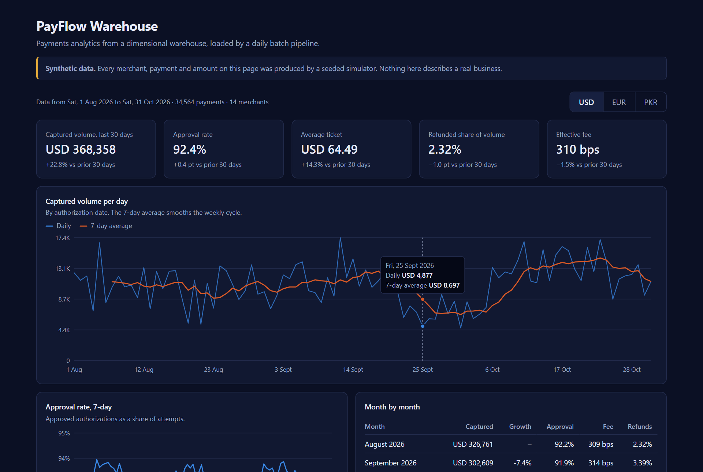
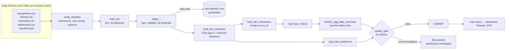
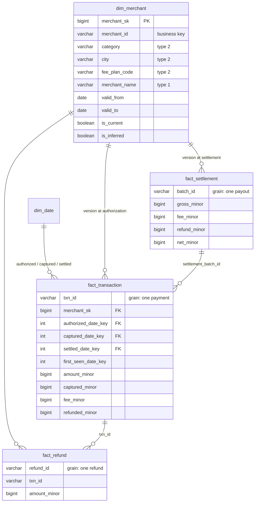
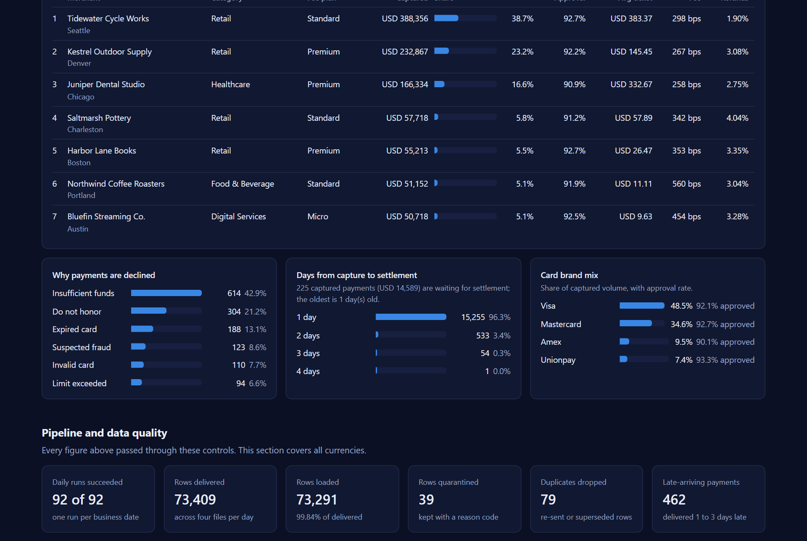
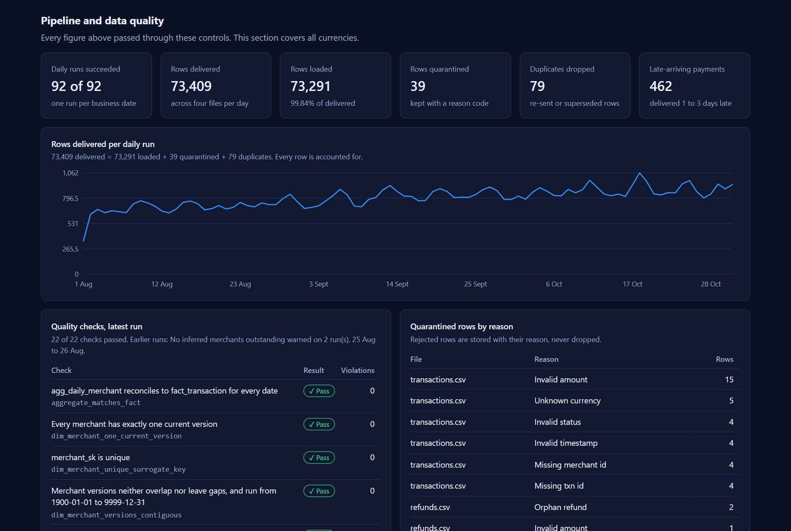
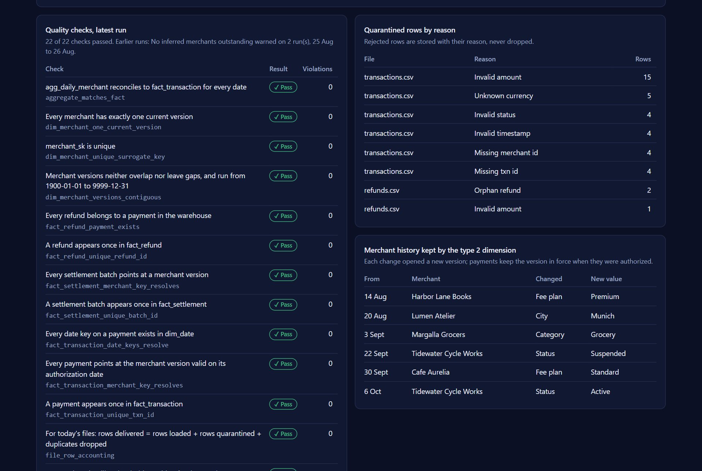

# PayFlow Warehouse

**A daily batch ELT pipeline that loads payment data into a dimensional warehouse, gates every load on data quality checks, and serves BI-ready marts and a dashboard.**

Python · SQL · DuckDB · star schema · slowly changing dimensions · data quality · GitHub Actions

> **Everything here is synthetic.** The source data comes from a seeded simulator. No merchant, payment or amount describes a real business, and no real card data is involved anywhere.

The analytics companion to [PayFlow Lab](https://github.com/hasnaat93/payflow-lab), which simulates the payment operations side. This project is standalone: it needs only Python.



---

## What it demonstrates

| Area | What is implemented |
|---|---|
| **Layered ELT** | `raw` (files landed as text, untouched) → `stg` (typed, validated, de-duplicated) → `dw` (star schema) → `mart` (views for BI). Transformations are plain `.sql` files; Python only orchestrates. |
| **Dimensional model** | An accumulating snapshot fact for payments, facts for refunds and settlement batches, a date dimension, and a type 2 slowly changing merchant dimension. |
| **Slowly changing dimension** | Attribute changes open a new merchant version; payments keep the version in force on their authorization date. Name corrections are type 1. Merchants that transact before their record arrives get a placeholder member that is completed later without changing its key. |
| **Incremental, idempotent loads** | Facts are merged on business keys. Re-running a date changes nothing. A payment is only overwritten by a newer source version, so old dates can be replayed without moving data backwards. Aggregates are rebuilt only for the dates a run touched. |
| **Messy input handled on purpose** | Duplicates, superseded versions, malformed amounts, unknown currencies, missing keys, bad timestamps, late-arriving payments and orphan refunds are all in the feed. Bad rows go to a quarantine table with a reason code. |
| **Control totals** | Each delivery has a manifest with row counts and SHA-256 checksums, verified before anything loads. For every file: rows delivered = rows loaded + rows quarantined + duplicates dropped. |
| **Data quality gate** | 22 SQL checks run at the end of every load: key uniqueness, dimension version integrity, referential integrity, business rules, settlement arithmetic and cross-layer reconciliation. |
| **All-or-nothing runs** | A business date loads in one transaction. If a task fails or an error-level check finds violations, everything rolls back and the warehouse stays at the last good state. The failure is still logged. |
| **Task graph** | The daily run is a small dependency graph with a run log: status, duration and row counts per task. |
| **Money correctness** | Amounts are parsed from text straight to integer minor units. `7.255` or `12.3x` is rejected, never rounded. Currencies are never added together. |
| **BI delivery** | Eleven mart views (CTEs and window functions), exported to Parquet and CSV for Power BI, Tableau or Metabase, plus a self-contained HTML dashboard. |

## Run it

Needs Python 3.11 or newer. No database server, no Docker.

```bash
python -m venv .venv
source .venv/bin/activate            # Windows: .venv\Scripts\activate
pip install -e ".[dev]"

pfw demo
```

`pfw demo` generates 92 days of synthetic deliveries, runs the pipeline once per business date, builds the dashboard at `site/index.html` and writes the marts to `exports/`. It takes about half a minute.

Then explore:

```bash
pfw status                       # row counts, recent runs, quarantine, warnings
pfw run --date 2026-10-31        # replay one day: every task, nothing changes
duckdb warehouse/payflow.duckdb  # or any DuckDB client; query dw.* and mart.*
```

| Command | What it does |
|---|---|
| `pfw generate` | Write synthetic daily deliveries to `data/landing/` (`--start`, `--days`, `--seed`) |
| `pfw run --date D` | Process one business date |
| `pfw backfill` | Process every delivered date in order, stopping at the first failure (`--from`, `--to`) |
| `pfw status` | Warehouse row counts, latest runs, quarantined rows, checks that did not pass |
| `pfw export` | Write the mart views as Parquet and CSV |
| `pfw dashboard` | Build the static HTML dashboard |

## How a daily run works



The run log, task timings and check results are written after the commit or rollback, so a failed run leaves evidence but no data.

## The model



Details and the reasoning behind each choice: [docs/data-model.md](docs/data-model.md) · [docs/design-notes.md](docs/design-notes.md).

## Dashboard

Built by `pfw dashboard` from the mart views. One HTML file with its data embedded: no server and no external requests.

| Merchants, declines, settlement | Pipeline figures |
|---|---|
|  |  |

| Quality checks, quarantine and merchant history |
|---|
|  |

## Using the marts in a BI tool

`pfw export` writes every `mart.*` view to `exports/` as both Parquet and CSV.

- **Power BI / Tableau:** load the Parquet or CSV files directly.
- **Metabase and other SQL tools:** connect to `warehouse/payflow.duckdb` with a DuckDB driver and query the `mart` schema.

| View | Grain | Use |
|---|---|---|
| `mart.daily_kpis` | day × currency | Volume, approval rate, 7-day averages, week-over-week change |
| `mart.monthly_summary` | month × currency | Month-over-month growth, effective fee, refund rate |
| `mart.merchant_scorecard` | merchant | Rank and share within currency, approval, ticket, refunds |
| `mart.decline_reasons` | reason × currency | Decline mix |
| `mart.card_brand_mix` | brand × currency | Volume share and approval by brand |
| `mart.settlement_lag` | lag days × currency | Capture-to-settlement time |
| `mart.unsettled_aging` | merchant | Captured payments still awaiting payout, in age bands |
| `mart.settlement_reconciliation` | batch | Each payout against the payments held for it |
| `mart.merchant_history` | merchant version | What changed and when |
| `mart.late_arrivals` | delivery day × days late | Late-arriving payments |
| `mart.load_accounting` | business date | Delivered, loaded, quarantined, duplicates |

## Tests

```bash
pytest          # 46 tests
ruff check .
```

- **Hand-built scenarios with known answers:** every rejection reason, de-duplication, exact money parsing, the accumulating snapshot, type 1 and type 2 changes, placeholder merchants, late arrivals, orphan refunds, replaying a date, replaying an old date.
- **Failure handling:** a tampered file, a changed file layout, a wrong row count, a missing delivery, and a deliberately injected duplicate that the quality gate must catch and roll back.
- **End to end:** a 45-day simulated feed is loaded day by day, then the warehouse is compared payment by payment with the simulator's own record of what it delivered.

What was run, and what was not, is in [IMPLEMENTATION_STATUS.md](IMPLEMENTATION_STATUS.md).

## Limitations

- A portfolio project on synthetic data. It is not connected to any payment system.
- DuckDB is a single-file, single-writer database. The SQL is close to PostgreSQL's, but nothing here has been run on PostgreSQL, Greenplum or a cloud warehouse.
- The scheduler is the command line: one run per business date, in order. There is no retry policy, alerting or parallel task execution. In production this graph would sit in a scheduler such as Airflow.
- Merchant snapshots must be applied in date order. An older snapshot is skipped rather than merged into history.
- A structurally broken CSV (wrong number of fields in a row) fails the whole run instead of quarantining the row.
- Three currencies, all with two minor digits. No currency conversion.
- Data volume is small (about 35,000 payments), so nothing here says anything about performance at scale.

## Licence

[MIT](LICENSE)
